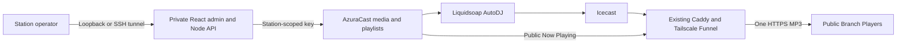

# Private Ghmaas Baladi administration

The admin UI and its API run together at **http://127.0.0.1:18090/admin** on the WSL host. On mobile, connect to the authorized tailnet and use the separate private HTTPS Admin. Restaurant staff continue to use the public Branch Player. Keep port 18090 off Tailscale Funnel and out of the public Caddy configuration. [Mobile Admin access](../docker/mobile.md) · [Public Branch Player](https://hussam.tail1a8390.ts.net/player)



Node and Express share the frontend toolchain and need a single private process. AzuraCast owns the catalog and rotation. The service keeps short-lived sessions in memory and deletes its bounded upload scratch files after each request.

## Build and start

Run these commands in Ubuntu WSL2 from the repository root. Required tools are Node 20.19 or newer, npm, FFmpeg with `ffprobe`, the working local AzuraCast installation, and the existing local Caddy listener on port 8088.

```bash
cd ~/cdr-radio-platform
npm ci --prefix backend
npm ci --prefix frontend
npm run build --prefix backend
VITE_ADMIN_ENABLED=true \
VITE_PUBLIC_RADIO_ORIGIN=https://hussam.tail1a8390.ts.net \
VITE_AZURACAST_STATION=ghmaas_baladi_radio \
VITE_STREAM_URL= npm run build --prefix frontend -- --outDir dist-admin --emptyOutDir
```

Only the private build uses `VITE_ADMIN_ENABLED=true`. The public Caddy document root remains `frontend/dist`. The admin process rejects that path as its private document root.

### Set up the two accounts

1. In local AzuraCast, go to **System Administration → Users → Roles & Permissions → Add Role**. Leave **Global Permissions** empty. Under **Station Permissions → Add Station**, select **Ghmaas Baladi Radio** and grant **Manage Station Media**. The installed file and playlist routes use that permission.
2. Under **Users → User Accounts → Add User**, create a dedicated service account with only that role. Sign in as the account and open **My Account → API Keys → Add API Key → Create New Key**.
3. Generate a separate private app password in your password manager, then run the helper from a local interactive terminal. Paste the key and enter the private app password at the hidden prompts. The helper uses the existing scrypt password utility, validates the fixed loopback configuration, and creates a mode-600 `backend/.env` atomically. It stops if that file already exists. Sign in to the private app as `radio-operator` using your original private app password. Keep credentials out of chat, shell history, and frontend configuration.

```bash
bash deploy/admin/configure-operator.sh
```

| Setting | Use |
|---|---|
| `ADMIN_ORIGIN` | Exact browser origin. Default `http://127.0.0.1:18090`. The process checks both Host and Origin. |
| `ADMIN_LISTEN_PORT` | Default 18090. The process always binds `127.0.0.1`. |
| `ADMIN_FRONTEND_DIR` | Private build path, relative to `backend` unless absolute. |
| `ADMIN_USERNAME`, `ADMIN_PASSWORD_HASH` | Private app login and scrypt password hash. |
| `ADMIN_MANAGEMENT_MODE` | Defaults to `read-only`. The owner can explicitly set `persistent` for ordinary private music management. For Compose, use `GHMAAS_ADMIN_MANAGEMENT_MODE` in the project-root `.env`. |
| `ADMIN_ALLOW_WRITES` | Reserved for the scoped test. It requires the approved SHA-256 and deadline and cannot be combined with persistent management. |
| `ADMIN_UPLOAD_MIB` | Maximum per file, 1–24 MiB. The default 24 MiB expands to about 32 MiB in AzuraCast’s base64 request, below the installed 50 MiB Nginx/PHP body limits. A smaller upstream limit may still produce a rejection. |
| `AZURACAST_ORIGIN` | Direct AzuraCast origin on the same host. Defaults to `http://127.0.0.1`. A non-loopback origin requires HTTPS with normal TLS verification. |
| `AZURACAST_API_KEY` | Dedicated server-side AzuraCast key. |

Leave writes disabled for the first start and for authenticated read-only verification.

```bash
ADMIN_MANAGEMENT_MODE=read-only ADMIN_ALLOW_WRITES=false npm run verify:live --prefix backend
ADMIN_MANAGEMENT_MODE=read-only ADMIN_ALLOW_WRITES=false npm start --prefix backend
```

Use **http://127.0.0.1:18090/admin** in a browser. The WSL browser or Windows host can use the local loopback forwarding available on the machine. For an operator with SSH access over a private tailnet, keep the same URL and use an SSH tunnel from the operator’s machine.

```bash
ssh -N -o ExitOnForwardFailure=yes -L 127.0.0.1:18090:127.0.0.1:18090 OPERATOR@PRIVATE_WSL_SSH_HOST
```

An existing trusted private HTTPS terminator can use its HTTPS origin in `ADMIN_ORIGIN`, preserve that Host, pass the browser’s Origin unchanged, and proxy exclusively to the loopback service. HTTPS uses a Secure host-only cookie. Configure a private ACL outside Funnel and verify its reachability before use. This repository adds no listener outside loopback.

## Operator and branch workflows

1. In the private admin, sign in and check **Station overview** for the current and upcoming track, the active playlist, and the station-wide listener count.
2. In **Upload Music**, drop approved MP3 or PCM WAV files or use **Browse files**. Select up to 10 files and use **Upload selected**. The upload queue sends one file at a time and shows the browser transfer progress. After transfer, it waits for the media record to be read back from AzuraCast.
3. Use **View in library** to verify the result, or open **Music Library** and search by title, artist, or file name. Use the playlist filter to narrow results to the main rotation. An uploaded file stays outside the rotation until you use **Add to Main Rotation**.
4. Open **Main Rotation**. In Sequential mode, use **Up** and **Down**, then **Save order** and confirm. The app reads the order back. Remove a track with **Remove** and confirm. This removes its rotation membership while retaining the media file. Folder-derived membership can be managed by a station operator in AzuraCast.
5. Check Overview and listen through the public player. AutoDJ may play tracks that were already queued before a change. Wait for the selected track to become eligible. Keep playback going while checking for the transition.

Restaurant staff open the same [Branch Player](https://hussam.tail1a8390.ts.net/player), then tap **Play**. Staff can bookmark the link and use local pause, mute, volume, or Retry. Icecast buffering varies by device and network. [Direct MP3](https://hussam.tail1a8390.ts.net/listen/ghmaas_baladi_radio/radio.mp3)

The duplicate check compares file bytes against library entries of matching size, including files added directly in AzuraCast. A renamed copy still matches. Re-encoding changes the bytes, so search the library for the same recording before uploading. After a timeout, check the library or rotation before retrying.

After a sequential assignment, the backend checks both the saved media membership and the playlist entries. The added entry must occur once at a weight higher than the previous maximum. Existing entries retain their entry IDs, media IDs and weights. AzuraCast can return tied-weight entries in a different relative order. [iPhone upload and on-air verification](../../docs/testing.md#iphone-upload-and-on-air-verification)

## Application API

Every route below is under `/admin-api` on the private origin. The login requires a same-origin JSON request. Session cookies are HttpOnly and SameSite Strict. Protected writes require the exact Origin plus the `X-CSRF-Token` returned by login or `auth/me`. The session expires after four hours. Logout or restarting the private service invalidates it. Login attempts are limited to eight failures per 15 minutes across this single-process private endpoint, with a two-request hashing limit.

| Method and path | Request → response |
|---|---|
| POST `/auth/login` | `{username,password}` → session cookie, username, CSRF token, expiration, write permission and per-file limit |
| GET `/auth/me` | Session cookie → the same session metadata |
| POST `/auth/logout` | Auth and CSRF → `204` and expired session cookie |
| GET `/station` | Station status, real current and next tracks, station-wide listeners and rotation configuration |
| GET `/media?q=&page=1&scope=all` | 25 records per page, counts, track metadata and playlist memberships. Use `scope=rotation` to limit results to the main rotation. |
| POST `/media/upload` | Raw audio bytes, `Content-Type: application/octet-stream`, known length, and percent-encoded `X-File-Name` → `201` with a verified, unassigned media record |
| GET `/playlists?page=1` | Paginated station playlist summaries. Only ID 2 is managed. |
| GET `/playlists/2?page=1` | Rotation mode, enabled status, current on-air playlist when available, and assigned tracks with playlist entry IDs when sequential |
| POST `/playlists/2/tracks` | `{trackId}` → verified memberships on the media record |
| DELETE `/playlists/2/tracks/:trackId` | → media record with the target membership removed and unrelated memberships preserved |
| PUT `/playlists/2/order` | `{baseline: number[], order: number[]}` using playlist-entry IDs → verified order. The baseline must match AzuraCast and the order must be a complete permutation. |

Errors return a sanitized `{code,message}`. Statuses include `400` invalid request, `401` sign-in required, `403` authorization or origin denial, `404` missing resource, `409` conflict, `413` size limit, `422` invalid audio or playlist order, `429` login rate limit, and `502`–`504` upstream errors. Request logs include request ID, method, status, and route template. Verified music actions also log the mode, action and relevant station, media and playlist IDs. Logs omit request bodies, raw paths, cookies, key material, and upstream error messages.

## Installed AzuraCast contract

The running server provided `/api/openapi.yml` for 0.24.1. The installed controller and route sources clarify the order payload and membership semantics where the OpenAPI schema omits detail. Station `1` is `ghmaas_baladi_radio`. Playlist `2` is `Ghmaas Main Rotation`, enabled, with songs and Sequential mode at inspection time.

| Installed route under `/api` | Usage |
|---|---|
| GET `/nowplaying/ghmaas_baladi_radio` | Public status, on-air playlist, and current and next tracks. No API key. |
| GET `/station/1/files` | Server-side search with `searchPhrase`, `page`, and `per_page`. |
| POST `/station/1/files` | External JSON upload with `path` and base64 `file`. The service derives the path from a content hash and sanitized name and streams the encoding from its bounded temporary file. |
| GET `/station/1/file/:id` | Verify upload and read memberships before and after a change. |
| PUT `/station/1/file/:id` | Supported media editing. The application sends only `playlists` to change membership and preserves the other IDs. It offers no arbitrary tag editing. |
| GET `/station/1/playlists`, GET `/station/1/playlist/2` | Station collection and central rotation configuration. |
| GET `/station/1/playlist/2/order` | Sequential entry rows with distinct entry and media IDs. |
| PUT `/station/1/playlist/2/order` | `{order: {entryId: oneBasedWeight}}`. Changing playback mode is outside this workflow. |
| GET `/station/1/files/list` | Uses the installed `playlist:2` search syntax if the station changes the rotation to a non-sequential mode. |
| GET `/station/1/playlists/schedule` | Installed calendar endpoint. The UI reports whether the central playlist has a schedule. Schedule editing stays in private AzuraCast. |

`PUT /playlist/:id/members` edits playlist groups in this installation. Music membership uses the file endpoint. The private service serializes mutations and verifies the results. Avoid making simultaneous edits directly in AzuraCast through another session because its file API does not provide an atomic version check.

## Acceptance and rollback

1. Run the automated checks below. Set up the service key manually. With writes disabled, run the authenticated verification command and save the baseline under a private path. The file must not already exist.

   ```bash
   umask 077
   snapshot_dir=$(mktemp -d)
   npm run verify:live --prefix backend -- "$snapshot_dir/rotation-before.json"
   node deploy/demo/smoke-test.mjs
   ```
2. For the mobile test, choose an original or licensed MP3. Record its filename, byte size and `sha256sum`. Use authenticated reads to check matching-size files for the same SHA-256. Propose one upload, a library read-back, and an append to playlist 2. Assignment can affect upcoming tracks at every branch. Let AutoDJ play its existing queue.
3. **Wait for explicit owner approval of the exact file and playlist actions.** For Docker, use the [scoped Compose upload window](../docker/README.md#approved-mobile-upload-test) with the mobile overlay enabled. Verify the new track in Now Playing and by listening on the public player after it becomes eligible.
4. To restore the rotation within the approved scope, remove the test track’s membership in the private app and compare the result with the saved entry order. Restore that order only if it changed and the owner approved restoration. Already queued tracks may still play. Keep the catalog entry unless the owner separately approves deletion by an operator with **Delete Station Media** permission. Return the private service to read-only.
5. For a private application rollback, stop Node with Ctrl+C or point `ADMIN_FRONTEND_DIR` at an earlier private build and start the corresponding private backend. The public site continues on `frontend/dist`. AzuraCast backup and restore procedures are in the [existing deployment runbook](../production/README.md).

After read-only acceptance and separate deployment approval, retain the private-service network boundary and deploy only the private Node service and private build. The published listener site needs no release for these changes.

## Verification and troubleshooting

```bash
npm run lint --prefix frontend
npm run check --prefix backend
npm run test --prefix backend
npm exec --prefix backend -- playwright install chromium
npm run test:browser --prefix backend
npm run test:public --prefix backend
node deploy/demo/smoke-test.mjs
node deploy/demo/smoke-test.mjs https://hussam.tail1a8390.ts.net
```

Run the browser suite after building `frontend/dist-admin`. Set `PUBLIC_FUNNEL_IP` to a public A record for the public browser and HTTPS smoke tests if WSL resolves the tailnet address. The isolated backend and admin browser suites use generated MP3/WAV fixtures and isolate the external AzuraCast API. They do not change the station.

- **403 from AzuraCast**. Confirm the service account’s role has Manage Station Media for station 1 and the API key is active. Try the read-only verification again.
- **Admin browser cannot connect**. Check `ss -ltn 'sport = :18090'`, use the literal `127.0.0.1` URL, and check Node startup output and any local SSH tunnel.
- **Upload rejected**. Check source format, configured size and storage quotas. Test `ffprobe -version` on the host. Read the library before retrying after a timeout.
- **Playlist changed during save**. Refresh the rotation before moving tracks and confirm the new order. Keep concurrent changes in one operator session.
- **Public TLS from WSL**. Test on a device outside the tailnet or resolve a public Funnel A record and use `curl --resolve "hussam.tail1a8390.ts.net:443:PUBLIC_FUNNEL_IP"` with the original HTTPS hostname. Keep normal certificate verification.
