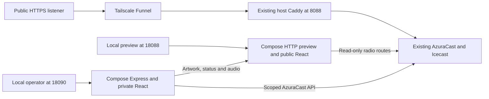

# Ghmaas Baladi Radio in Docker Compose

This project builds the two React variants and the private Node backend. It uses the existing external `azuracast_default` bridge. AzuraCast, Icecast, Liquidsoap, the live host Caddy, and Tailscale are managed separately.



| Service | Published host address | Container address |
|---|---|---|
| Frontend preview | `127.0.0.1:18088` | `frontend:8080` |
| Private admin | `127.0.0.1:18090` | `backend:18090` |

## One-time prerequisites

- Run Docker Engine and Compose V2 in the same Ubuntu WSL instance as AzuraCast. The existing network must contain the `azuracast` alias. `docker network inspect azuracast_default` confirms which containers share it. Compose never creates or removes that external bridge.
- Create the dedicated operator role and local configuration using the [private setup instructions](../admin/README.md). Run `bash deploy/admin/configure-operator.sh` only if `backend/.env` is absent. A missing file fails Compose’s secret mount with its file path. A file with the wrong mode or owner fails the backend’s startup check with a configuration diagnostic. On this machine the runtime UID and GID are both 1000. Set `GHMAAS_UID` and `GHMAAS_GID` to the file owner’s numeric IDs on another host and keep the file at mode 600.
- Ports 18088 and 18090 must be free. If a manual admin is using 18090, verify its PID and that no writes or uploads are active. Stop only that process gracefully before starting the containerized replacement. The move invalidates existing private admin sessions. Restaurant listeners continue using host Caddy.

## Run

From the project root:

```bash
docker compose up -d --build
docker compose ps
docker compose logs --tail=100
```

On the assessment WSL host, Compose V2.40.3 crashed in its Bake builder. Setting `COMPOSE_BAKE=false` in the ignored project-root `.env` selects the working builder. On another host, add the setting only if the same builder crash occurs. The project-root file holds Compose settings. The operator credentials are in `backend/.env`.

Use [Docker preview](http://127.0.0.1:18088/) or its [player](http://127.0.0.1:18088/player) and [Private Admin](http://127.0.0.1:18090/admin). The preview shares the existing public HTTPS player link. Its HTTP server normalizes AzuraCast’s cached media URLs to the preview origin and runs independently of the private admin. Restaurants continue using the [published Branch Player](https://hussam.tail1a8390.ts.net/player).

The [mobile access runbook](mobile.md) covers the separate tailnet-private HTTPS Admin node and actual phone checks.

```bash
docker compose restart
docker compose down
```

These commands are scoped to `ghmaas-radio-app`. They leave the existing radio containers and external network in place. Both application containers have `restart: unless-stopped`. Windows and WSL must remain running for the demo to be available.

## Private music writes

Compose defaults to `GHMAAS_ADMIN_MANAGEMENT_MODE=read-only`. The owner can explicitly authorize persistent mode for the existing radio administrator. In this mode, the operator signs in on [Windows](http://127.0.0.1:18090/admin) or through [private Tailscale HTTPS](https://ghmaas-admin.tail1a8390.ts.net/admin) and uses Upload Music, Music Library, and Main Rotation without opening a per-file window.

After owner authorization, put these settings in the ignored project-root `.env`. Leave the two approval-window fields unset, and close any running approved-upload terminal session first.

```dotenv
GHMAAS_ADMIN_MANAGEMENT_MODE=persistent
GHMAAS_ADMIN_ALLOW_WRITES=false
```

Recreate only the backend from the updated source. On the enrolled host, `docker compose config --services` should include `admin-tailnet` so the backend keeps its private HTTPS socket. Backend recreation expires active Admin sessions. Saved mode settings survive normal container restarts and recreations. Apply any later setting change with `docker compose up`. [Mobile Compose configuration](mobile.md#stage-and-enroll)

```bash
docker compose config --quiet
docker compose up -d --no-deps --build --wait backend
docker compose ps backend
```

Persistent mode requires the existing operator login, the exact Origin and CSRF token on mutations, and Tailscale identity for the phone. Upload stores and verifies supported MP3 or PCM WAV audio up to 24 MiB in the catalog. The server compares SHA-256 against library files of matching indexed size. **Add to Main Rotation**, **Remove** and **Save order** are separate actions scoped to playlist 2. Removal keeps the media in the catalog. Verified actions are logged with the request ID, mode and relevant station, media and playlist IDs.

### Return to read-only

Set `GHMAAS_ADMIN_MANAGEMENT_MODE=read-only` in the project-root `.env` and recreate the backend with `docker compose up -d --no-deps --no-build --wait backend`. To override the saved mode immediately, run the command below. Save the read-only setting as well so a later `up` keeps it.

```bash
GHMAAS_ADMIN_MANAGEMENT_MODE=read-only GHMAAS_ADMIN_ALLOW_WRITES=false \
  GHMAAS_APPROVED_UPLOAD_SHA256= GHMAAS_WRITE_WINDOW_EXPIRES_AT= \
  docker compose up -d --no-deps --no-build --wait backend
```

## Approved mobile upload test

Use this option with the saved mode set to read-only. Run it in WSL with the absolute path of the same original or licensed MP3 you will select on the phone. It saves the file identity and playlist baseline using read-only checks before prompting for approval. `GHMAAS_ADMIN_ALLOW_WRITES` is reserved for this scoped window. The backend rejects it without a valid hash and deadline and rejects combining it with persistent mode.

```bash
bash deploy/docker/approved-upload.sh window /absolute/path/to/approved.mp3
```

1. Enter the printed `APPROVE <SHA-256> ADD TO 2` line once, after reviewing the file and confirming approval for its addition to playlist 2.
2. At **UPLOAD WINDOW ACTIVE**, leave the terminal open. The backend verifies the approved hash and enforces a 20-minute write deadline.
3. In Safari, sign in to [Upload Music](https://ghmaas-admin.tail1a8390.ts.net/admin/upload) with Tailscale connected. Choose the approved MP3 from iOS Files, upload it, and wait for library verification.
4. Use **Add to Main Rotation** in the same upload queue and wait for confirmation.
5. Type `CLOSE` on its own line. The script verifies backend health and read-only mode, then checks the catalog and rotation. Listen on the public player to verify on-air playback when AutoDJ reaches the track.

The close prompt ignores blank lines, whitespace, and repeated approval text. At the deadline, the server rejects new writes. Let any in-flight request settle, then type `CLOSE`. If the approved file already appears in the library, review its membership before retrying. To run just the duplicate and audio checks, use `preflight` in place of `window`.

Normal closure and termination restore the saved read-only state. If the terminal reports a security warning or the operator process is killed before it can restore read-only, run the following after any pending request settles. The app enforces the timestamp even if the script cannot finish cleanup.

```bash
GHMAAS_ADMIN_MANAGEMENT_MODE=read-only GHMAAS_ADMIN_ALLOW_WRITES=false \
  GHMAAS_APPROVED_UPLOAD_SHA256= GHMAAS_WRITE_WINDOW_EXPIRES_AT= \
  docker compose up -d --no-deps --no-build --wait backend
```

Run the terminal regression tests with `python3 deploy/docker/tests/approved-upload.test.py`. They use a private pseudo-terminal and an isolated Compose fixture.

## Verify

```bash
docker compose config --quiet
node deploy/docker/smoke-test.mjs
RADIO_PUBLIC_ORIGIN=http://127.0.0.1:18088 npm run test:public --prefix backend
docker compose exec -T backend node --env-file=/run/secrets/ghmaas_operator dist/verify.js
```

The runtime verification uses the actual backend container and its mounted key to read station 1, media, playlist 2 and the rotation entries. The HTTP health checks verify the local processes. The integration command verifies upstream authorization. Administrator login uses the separate private app password. To verify the real browser workflow locally without echoing that password:

```bash
(
  set +x
  read -rsp 'Private admin password: ' cdr_browser_password
  printf '\n'
  printf '%s' "$cdr_browser_password" | node deploy/docker/operator-browser.mjs radio-operator
)
```

Use the configured username in place of `radio-operator` if it differs. Without a file argument the check expects read-only mode. For write-enabled mode, pass the path of a local MP3 or PCM WAV as the second argument to `operator-browser.mjs`. The check verifies real operator login, the catalog, CSRF enforcement, and that choosing the file enables its upload button. It leaves the file in the browser queue until logout without submitting it.

## Boundaries and future promotion

Both host bindings are IPv4 loopback. The processes in their containers listen on the container interfaces needed for Docker forwarding. The frontend exposes only the station’s allowlisted public routes and rejects administration routes and writes. The private backend applies Host, Origin, session and CSRF validation in every mode.

The operator file is excluded from the build context. Compose uses a read-only file-backed secret and keeps the actual values out of image layers, build args and Compose environment declarations. Local Compose implements this as a bind mount, so the source ownership and permissions apply. Host root, Docker administrators and processes authorized to read the file can access it. Keep untrusted containers off the shared AzuraCast bridge. The backend sends its key only to the fixed `http://azuracast` address over that bridge. The host-mode backend retains its existing HTTPS-or-loopback rule. The preview receives no key.

The images run as non-root with read-only filesystems, bounded temporary storage, dropped capabilities and bounded logs. The backend image includes Debian’s FFprobe package tooling for existing file validation. The public deployment continues to serve the original host `frontend/dist`. A future approved migration can switch only the SPA and static asset handlers to the loopback Docker frontend, keeping host Caddy’s existing radio API, artwork and MP3 handlers and the Funnel mapping in place. Verify host headers, media URLs and browser playback, and retain the previous static root for rollback.
