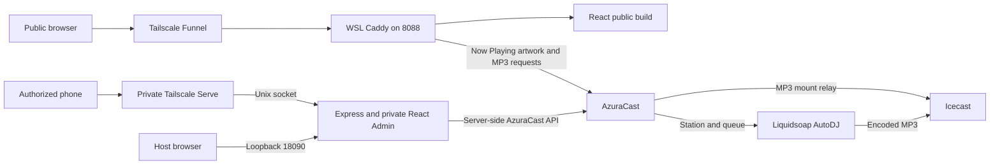

# Ghmaas Baladi Radio technical architecture

The assessment runs on a Windows laptop with Ubuntu WSL2. The public site and the private operator console use separate ingress paths and share one AzuraCast station.

## Public and private request paths

| Surface | Runtime and boundary |
| --- | --- |
| Public assessment | WSL Tailscale Funnel terminates HTTPS and forwards to Caddy on loopback port 8088. Caddy serves `frontend/dist` and proxies station-specific `GET` and `HEAD` requests for Now Playing, artwork and stream audio. Public admin paths return 404. |
| Station | AzuraCast stores media, playlist memberships, weights and history. Station ID `1` has shortcode `ghmaas_baladi_radio`. Playlist ID `2` is the enabled, sequential, song-based Ghmaas Main Rotation. |
| Broadcast | Liquidsoap reads the AutoDJ queue and encodes audio for the Icecast MP3 mount. All branches hear the same program. Each browser has its own stream connection and buffer. |
| Private Admin | Express serves the private React build and `/admin-api`. The host binding is `127.0.0.1:18090`. The tailnet-only HTTPS service reaches Express through `/run/ghmaas-tailnet/admin.sock`. |
| Docker preview | Loopback port `18088` serves a separate public build that reads the same station. Host Caddy continues to serve the assessment release. |

The browser polls Now Playing separately from audio. Metadata can advance before a buffered listener reaches the next track. The player can measure its own startup and playback progress. The MP3 mount supplies no source timestamp for measuring delay from live.

## Admin authentication and music workflow

At the private HTTPS endpoint, Tailscale Serve establishes the operator's network identity. Express checks that identity and the forwarded host and protocol. The operator also signs in with a separate Admin account. HTTPS uses a Secure, HttpOnly, SameSite Strict session cookie. Writes require the configured Origin and a valid CSRF token. Sessions live in backend memory for up to four hours. Replacing the backend requires operators to sign in again.

The AzuraCast key stays server-side in the mode-600 operator file mounted into the backend. The application validates station and playlist scope. Compose uses the existing `azuracast_default` network and its `azuracast` alias. The live assessment uses persistent operator management, while the Compose default is read-only. The scoped upload window is a separate mode for one approved file and its assignment.

Upload verifies that an audio file was stored in the catalog. **Add to Main Rotation** is a separate action. The backend reads the media record and playlist after the write. It matches existing entries by entry ID, media ID and weight and accepts permutations within a shared weight. The new track must occur exactly once at the end, with a weight above the previous maximum. Repeat assignment of a verified track returns success without a second upstream write.

AutoDJ may already have tracks queued. Verify the desired track in history and in the listener audio before counting it as aired. AzuraCast sorts sequential rows and queue entries by weight. Tracks with the same weight can appear in different relative orders. The Admin's **Save order** action assigns consecutive weights. Exact-weight restoration is a separate operator task.

[Private Admin setup and API](../deploy/admin/README.md) · [Compose modes](../deploy/docker/README.md#private-music-writes) · [Mobile tailnet setup](../deploy/docker/mobile.md)

## WSL2 audio pacing

On 25 November 2026, diagnostics measured a sustained pacing deficit at the Liquidsoap source and the Icecast, Caddy and Funnel outputs. Comparing frame counts against WSL's `CLOCK_MONOTONIC_RAW` showed approximately 0.98 seconds of audio delivered per second before the host time-service intervention. The operator stopped Windows Time on the assessment host at 15:32 Asia/Amman and disabled its startup during the diagnosis. The Funnel measurement rose to about 1.001 seconds of audio per second over the next seven minutes. The source and proxy measurements pointed to host clock behavior.

A later release audit measured 1.00011 seconds of audio per second over a steady 60-second window while Windows Time was running with demand start. Check the host's service state with `sc.exe query W32Time` and `sc.exe qc W32Time` in PowerShell. Measure audio before treating the earlier intervention as necessary. Record the connection, decoded audio duration, elapsed raw monotonic time and longest read gap. Discard the initial buffer burst when calculating sustained pacing. A physical iPhone Safari listening check complements the transport measurement.

## Deployment limitations

- Public availability depends on the laptop staying awake and online, WSL2 and Docker remaining active, and the public HTTPS endpoint staying reachable. The Linux VPS runbook describes a separate deployment option. [Public demo runbook](../deploy/demo/README.md#assessment-limits) · [Linux VPS runbook](../deploy/production/README.md)
- The station catalog, audio, settings and queue live in AzuraCast state. A fresh environment needs an installation, a matching station and playlist, authorized media, operator configuration and separate tailnet enrollment for mobile Admin.
- The assessment audit found wildcard WSL host publications for AzuraCast web, SFTP and station ports. It also observed that the deployed key could read protected station settings beyond the media workflow. Review host reachability and the effective service-account role before a wider rollout.
